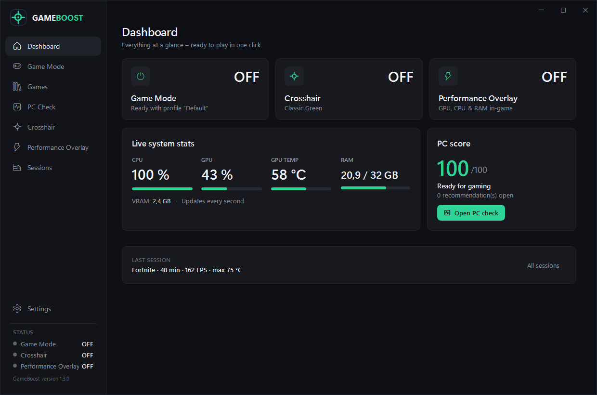
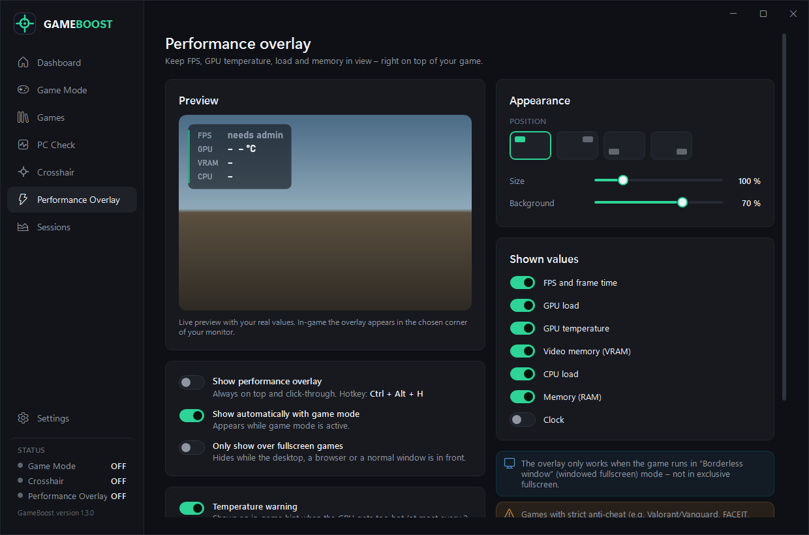
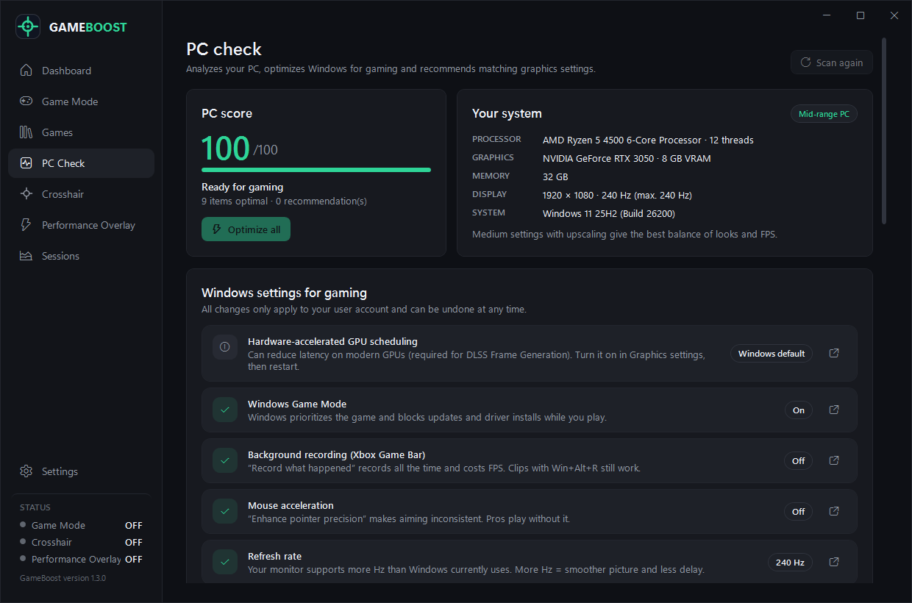
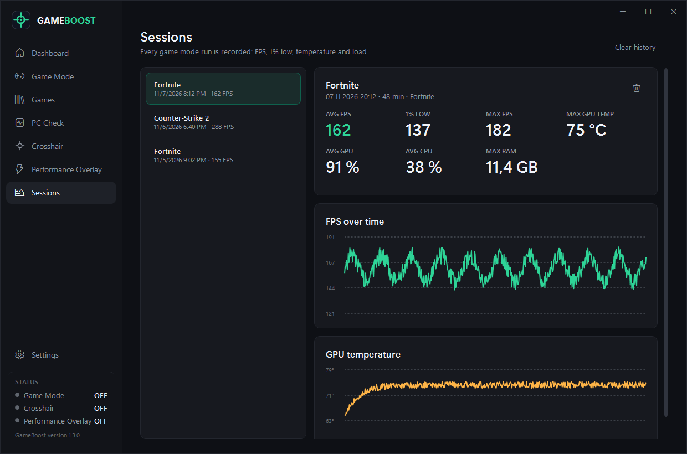
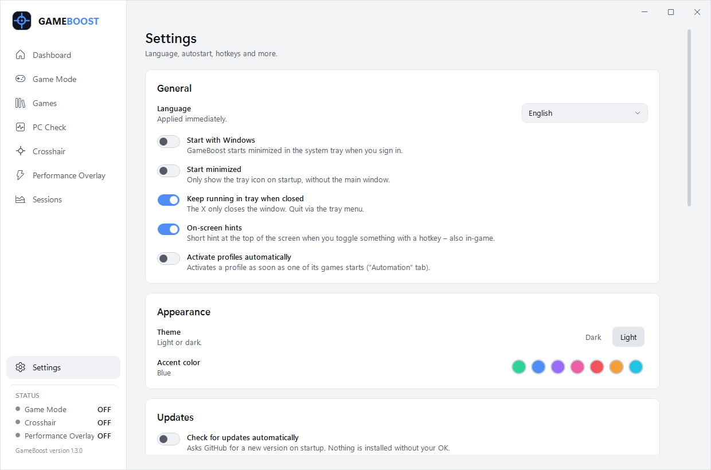

# GameBoost

**Game mode, in-game performance overlay, session reports, game library, PC check and crosshair overlay for Windows 10/11.**
One click for more performance and fewer distractions – plus FPS and GPU temperature right in your game.

Installer or portable `.exe`, free and open source.



---

## Features

### 📊 Performance overlay
- **FPS and frame time**, **GPU load and temperature**, **VRAM**, **CPU** and **RAM** – always visible on top of your game
- GPU temperature for NVIDIA, AMD and Intel **without extra drivers** (same source as Task Manager)
- Choose the **corner**, **size**, **background** and which values to show – with live preview
- Toggle with `Ctrl` + `Alt` + `H`, or show it **automatically with game mode**
- Optional: only show while a fullscreen/borderless game is in front
- Click-through, always on top, never in the taskbar or Alt+Tab
- **Temperature warning** (new in 1.3): an in-game hint when the GPU gets hotter than your limit

> FPS counting uses Windows event tracing (like PresentMon) and needs **administrator rights** – the app offers a one-click “Restart as administrator”. All other values work without admin. Supports DirectX 9–12 games.



### 🩺 PC check & cleanup
- Reads your **CPU, GPU, VRAM, RAM, display and Windows version** and gives your PC a **score**
- Checks the Windows settings that matter for gaming and fixes them **with one click** – every change has an **Undo** button:
  - Windows Game Mode · background recording (Xbox Game Bar) · mouse acceleration · refresh rate · optimizations for windowed games · power plan
- Hints for hardware-accelerated GPU scheduling, outdated graphics drivers, RAM and free disk space
- **Recommended in-game settings** matched to your hardware class: graphics preset, textures, shadows, anti-aliasing, DLSS/FSR, NVIDIA Reflex / AMD Anti-Lag, FPS limit, V-Sync …
- GameBoost **never changes game files** (important because of anti-cheat) – you apply the game settings in the game's menu
- **Free RAM** (new in 1.3): trims unused memory of background programs right before you play
- **Cleanup** (new in 1.3): temp files, crash dumps, old logs, DirectX and NVIDIA/AMD shader caches – shows the size first, skips files in use



### 🎮 Game mode
- **One button** (or `Ctrl` + `Alt` + `G`) turns everything on and off
- **Close background programs** you select from a list of running programs
- **Built-in safety:** system, Windows, security and anti-cheat processes are never listed and never closed
- **“High performance” power plan** while you play, previous plan restored afterwards
- **Windows notifications** suppressed while you play
- **Start programs** like Discord or a launcher automatically, and **restart closed programs** afterwards
- **Profiles** per game with **automation**: a profile turns on when the game starts and off when it closes
- **Crash-safe:** power plan and notifications are restored on the next start if anything goes wrong
- **Free RAM on start** per profile, and **export/import profiles** as `.gbprofile` files to share them (new in 1.3)

### 📚 Game library (new in 1.3)
- Finds installed games from **Steam, Epic Games and Riot** automatically, plus games you add by hand
- **Play** activates the linked game mode profile and starts the game through its launcher
- **Create profile** in one click – game mode then turns on automatically when that game starts

### 📈 Session reports (new in 1.3)
- Every game mode run is recorded: **average FPS, 1% low, max FPS, max GPU temperature, GPU/CPU load, RAM**
- **Charts** for FPS and GPU temperature over time, history of the last 200 sessions



### ✛ Crosshair overlay
- Styles: **cross, dot, circle, cross + dot, T-shape, X, square, circle + dot**
- **Hide while aiming:** disappears while the right mouse button is held (ADS / scope)
- Color, opacity, length, thickness, gap, dot size, outline, offset – with live preview and zoom
- **Pixel-exact center** of the selected monitor (multi-monitor and display scaling handled)
- **Presets** and **sharing by code** (`GB1-…`)


### ⌨️ Dashboard, hotkeys & comfort
- **Dashboard** with quick toggles, live system stats, PC score and hardware summary
- Global, customizable hotkeys that work in-game
- Keeps running in the **system tray**, optional **start with Windows**
- **On-screen hints** when you toggle something with a hotkey – also in-game
- **Dark or light mode** and **seven accent colors**
- **Automatic updates:** checks GitHub on startup; the installed version updates itself in one click
- **Discord status** (optional): shows “GameBoost – profile · game mode on” in your Discord profile
- English UI (German available in Settings)



---

## Download & run

Download from **[Releases](../../releases/latest)** – two options with the same app:

| | File | |
|---|---|---|
| **Installer** (recommended) | `GameBoost-Setup-x.y.z.exe` | Run it and follow the steps. Adds GameBoost to the Start menu (optionally the desktop) and to *Apps & features*, so it can be uninstalled like any other app. No admin rights needed – choose “Install for me only”. |
| **Portable** | `GameBoost-x.y.z-win-x64.zip` | Unzip anywhere and run `GameBoost.exe`. Nothing is installed. |

> **Windows SmartScreen:** the `.exe` is not digitally signed, so Windows may show “Windows protected your PC” on first launch. Click **More info → Run anyway**.

**Requirements:** Windows 10 (1809+) or Windows 11, 64-bit. .NET does not need to be installed. GPU temperature needs Windows 10 2004 or newer.

---

## Default hotkeys

| Action | Shortcut |
|---|---|
| Toggle game mode | `Ctrl` + `Alt` + `G` |
| Toggle performance overlay | `Ctrl` + `Alt` + `H` |
| Toggle crosshair | `Ctrl` + `Alt` + `C` |
| Next crosshair preset | `Ctrl` + `Alt` + `N` |

Change them under **Settings → Hotkeys**: click the field and press the new combination (`Del` = remove, `Esc` = cancel).


---

## ⚠️ Important notes

- **Borderless window:** overlays are only visible when the game runs in **borderless window / windowed fullscreen** mode – **not in exclusive fullscreen**.
- **Anti-cheat:** games with strict anti-cheat (e.g. Valorant/Vanguard, FACEIT, ESEA) or tournaments may disallow overlays. **Use at your own risk.** GameBoost does not touch games (no injection, no memory access) – it only draws its own transparent windows.
- **Closing programs:** unsaved data in closed programs is lost. Only select programs you don't need while gaming.
- **PC check changes** only affect your own Windows user account and can be undone at any time.

---

## FAQ

**Does GameBoost need admin rights?**
No – only the optional FPS counter does. Programs running as administrator can therefore not be closed by game mode.

**Why is there no CPU temperature?**
Reading CPU temperatures needs a kernel driver, which anti-cheat systems often block or flag. GameBoost deliberately avoids that.

**How do I turn on the Discord status?**
Discord needs an application ID: open the [Discord Developer Portal](https://discord.com/developers/applications), click *New Application*, name it “GameBoost”, copy the *Application ID* and paste it under *Settings → Discord*. Optionally upload an image named `logo` under *Rich Presence → Art Assets*.

**Where are my settings stored?**
In `%AppData%\GameBoost\settings.json`, sessions in `sessions.json`. Log files are in `%AppData%\GameBoost\logs`. Both can be opened from *Settings → Data & troubleshooting*.

**I can't see the overlay or crosshair.**
Set the game to borderless window mode, and pick the right screen under *Crosshair → Monitor*.

**How do I uninstall GameBoost?**
Installer version: *Settings → Apps → Installed apps → GameBoost → Uninstall* (this also removes the “Start with Windows” entry). Portable version: turn off “Start with Windows”, quit GameBoost from the tray menu, then delete `GameBoost.exe`. To also remove your settings, delete the folder `%AppData%\GameBoost`. Use *Undo* in the PC check first if you want to restore changed Windows settings.

---

## Build from source

Requirements: [.NET 8 SDK](https://dotnet.microsoft.com/download/dotnet/8.0) and [Inno Setup 6](https://jrsoftware.org/isdl.php) (for the installer)

```powershell
# Run the tests and create the portable ZIP and the installer (output in .\publish)
powershell -ExecutionPolicy Bypass -File build.ps1
```

For development:

```powershell
dotnet build GameBoost.sln
dotnet test GameBoost.sln
dotnet run --project src/GameBoost
```

### Project structure

```
src/GameBoost/
├── App.xaml(.cs)          startup, single instance, global error handling
├── AppController.cs       wires services, tray, hotkeys and windows together
├── Models/                settings, profiles, crosshair, HUD, hotkeys
├── Services/              GameModeService, OverlayService, HudService, SettingsService, HotkeyService,
│   │                      TrayService, ProcessGuard (safety rules), PowerPlanManager, SessionService,
│   │                      GameLibrary, UpdateService, DiscordPresenceService, TempCleaner, …
│   ├── Performance/       FPS (ETW), CPU/GPU/VRAM counters (PDH), GPU temperature (D3DKMT)
│   └── SystemCheck/       hardware detection, Windows checks + fixes, game setting recommendations
├── Rendering/             performance overlay renderer
├── ViewModels/            MVVM view models for the eight pages
├── Views/                 XAML UI, crosshair overlay and native layered overlay window
├── Controls/              CrosshairRenderer, HotkeyBox, SliderRow, LineChart
├── Infrastructure/        logger, localization (EN/DE), Win32 interop, converters
└── Themes/Theme.xaml      theme (dark; light mode and accent colors applied by ThemeService)
tests/GameBoost.Tests/     xUnit tests
installer/GameBoost.iss    Inno Setup script for the installer
website/                   landing page (static, deployable to Vercel – root directory: website)
```

**Tech:** C# 12, WPF, .NET 8, MVVM. Only dependency: `Microsoft.Diagnostics.Tracing.TraceEvent` for the FPS counter.

See [CHANGELOG.md](CHANGELOG.md) for all changes.

---

## Contributing

Found a bug or have an idea? Please open an issue and attach the log file from `%AppData%\GameBoost\logs`.
