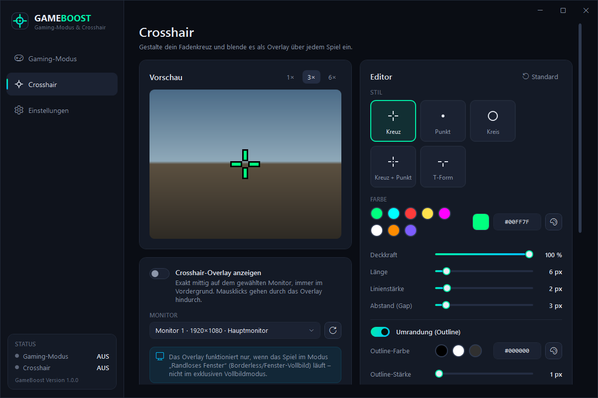
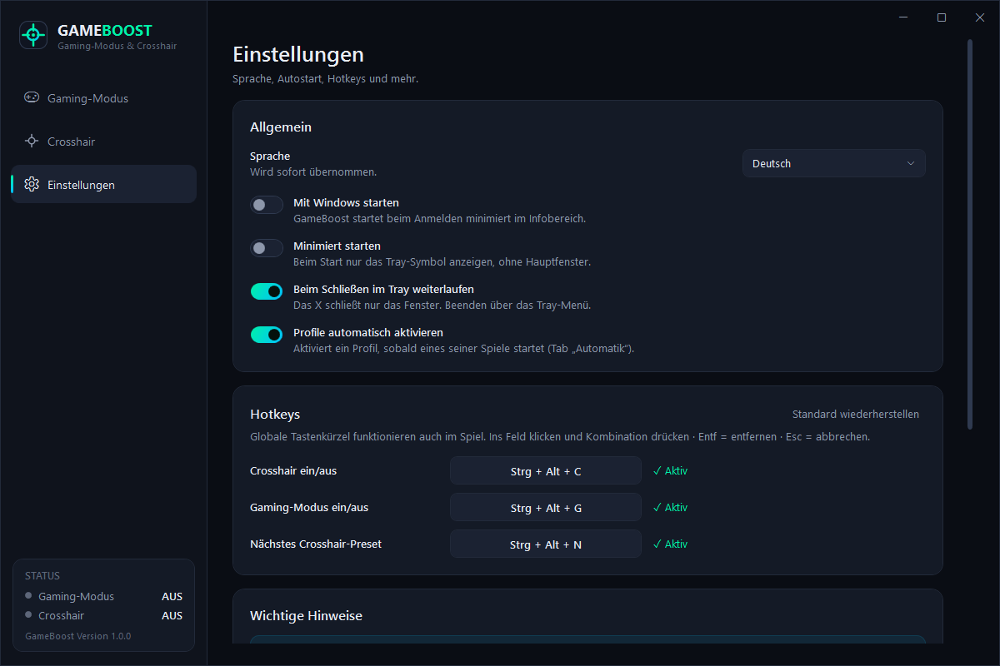

# GameBoost

**Gaming-Modus und Crosshair-Overlay für Windows 10/11** – ein Klick für mehr Leistung und weniger Ablenkung, dazu ein frei gestaltbares Fadenkreuz über jedem Spiel.

Keine Installation, keine Adminrechte, eine einzige `.exe`.



---

## Funktionen

### 🎮 Gaming-Modus
- **Ein Knopf** schaltet alles an und aus.
- **Hintergrundprogramme beenden** – du wählst per Haken aus einer Liste der laufenden Programme. Die Auswahl wird gespeichert.
- **Sicherheit eingebaut:** System-, Windows-, Sicherheits- und Anti-Cheat-Prozesse werden nie angezeigt und nie beendet. Es werden ausschließlich Programme deines eigenen Benutzerkontos berücksichtigt.
- **Energieplan „Höchstleistung“** wird aktiviert, der vorherige Plan gemerkt und danach wiederhergestellt.
- **Windows-Benachrichtigungen** werden während des Spielens unterdrückt.
- **Programme starten** – z. B. Discord, Steam oder einen Launcher automatisch mitstarten.
- **Beendete Programme neu starten**, wenn der Gaming-Modus ausgeschaltet wird (optional).
- **Profile** für verschiedene Spiele (z. B. „Valorant“, „Fortnite“).
- **Automatik:** Ein Profil startet von selbst, sobald die eingetragene Spiel-`.exe` läuft – und endet, wenn das Spiel geschlossen wird.
- **Absturzsicher:** Stürzt der PC oder GameBoost ab, werden Energieplan und Benachrichtigungen beim nächsten Start automatisch zurückgesetzt.

### ✛ Crosshair-Overlay
- Stile: **Kreuz, Punkt, Kreis, Kreuz + Punkt, T-Form**
- Farbe, Deckkraft, Länge, Linienstärke, Abstand (Gap), Punktgröße, Outline (an/aus, Farbe, Stärke), Offset X/Y
- **Live-Vorschau** mit Zoom (1×/3×/6×)
- **Pixelgenau mittig** auf dem gewählten Monitor – Multi-Monitor und Windows-Skalierung (DPI) werden berücksichtigt
- Immer im Vordergrund, **durchklickbar**, nicht in Taskleiste oder Alt+Tab
- **Presets** speichern, laden, überschreiben, löschen
- **Teilen per Code** (`GB1-…`) – kopieren, an Freunde schicken, importieren

### ⌨️ Hotkeys & Komfort
- Globale Hotkeys (frei belegbar) – funktionieren auch im Spiel
- Läuft im **Infobereich (Tray)** weiter, wenn das Fenster geschlossen wird
- Tray-Menü: Gaming-Modus, Crosshair, nächstes Preset, Öffnen, Beenden
- Optional **Autostart mit Windows**
- Oberfläche auf **Deutsch** oder **Englisch**



---

## Download & Start

1. Unter **[Releases](../../releases)** die neueste `GameBoost-x.y.z-win-x64.zip` herunterladen.
2. Entpacken und `GameBoost.exe` starten – fertig.

> **Windows SmartScreen:** Da die `.exe` nicht digital signiert ist, kann beim ersten Start „Der Computer wurde durch Windows geschützt“ erscheinen. Klicke auf **Weitere Informationen → Trotzdem ausführen**.

**Systemvoraussetzungen:** Windows 10 (1809+) oder Windows 11, 64-Bit. .NET muss nicht installiert sein.

---

## Bedienung

| Bereich | So geht's |
|---|---|
| **Gaming-Modus** | Profil wählen → großen Button drücken. Rechts siehst du, was passiert bzw. passiert ist. |
| **Programme beenden** | Tab „Programme beenden“ → gewünschte Programme anhaken. Nicht laufende, aber ausgewählte Programme bleiben in der Liste. |
| **Programme starten** | Tab „Programme starten“ → „Programm hinzufügen“ (`.exe` oder Verknüpfung). |
| **Automatik** | Tab „Automatik“ → Namen der Spiel-`.exe` eintragen (steht im Task-Manager unter „Details“, während das Spiel läuft) oder per „Durchsuchen…“ auswählen. |
| **Crosshair** | Seite „Crosshair“ → Stil und Werte einstellen → „Crosshair-Overlay anzeigen“ einschalten. |
| **Teilen** | Code unter „Dein Crosshair-Code“ kopieren; fremde Codes unter „Code importieren“ einfügen. |

### Standard-Hotkeys

| Aktion | Tastenkombination |
|---|---|
| Crosshair ein/aus | `Strg` + `Alt` + `C` |
| Gaming-Modus ein/aus | `Strg` + `Alt` + `G` |
| Nächstes Crosshair-Preset | `Strg` + `Alt` + `N` |

Ändern unter **Einstellungen → Hotkeys**: ins Feld klicken und neue Kombination drücken (`Entf` = entfernen, `Esc` = abbrechen). Ist eine Kombination schon von einem anderen Programm belegt, wird das angezeigt.

---

## ⚠️ Wichtige Hinweise

- **Randloses Fenster:** Das Overlay ist nur sichtbar, wenn das Spiel im Modus **„Randloses Fenster“ / „Fenster-Vollbild“ (Borderless)** läuft – **nicht im exklusiven Vollbild**.
- **Anti-Cheat:** Bei Spielen mit strengem Anti-Cheat (z. B. Valorant/Vanguard, FACEIT, ESEA) oder in Turnieren kann ein Overlay unerwünscht oder verboten sein. **Nutzung auf eigene Verantwortung.** GameBoost greift nicht in Spiele ein (keine Injection, kein Speicherzugriff) – es zeichnet nur ein eigenes, transparentes Fenster.
- **Programme beenden:** Ungespeicherte Daten in beendeten Programmen gehen verloren. Wähle nur Programme aus, die du beim Spielen nicht brauchst.
- **Benachrichtigungen:** GameBoost schaltet die Windows-Einstellung „Benachrichtigungen“ für deinen Benutzer aus. Bei manchen Windows-Versionen greift das erst für neue Benachrichtigungen.
- **Höchstleistung auf Laptops:** Fehlt der Energieplan „Höchstleistung“, legt GameBoost eine Kopie an. Geht das nicht (manche Modern-Standby-Geräte), wird stattdessen der Energiemodus „Beste Leistung“ gesetzt.

---

## FAQ

**Braucht GameBoost Administratorrechte?**
Nein. Alles läuft mit normalen Benutzerrechten. Programme, die als Administrator laufen, können deshalb nicht beendet werden.

**Wo werden meine Einstellungen gespeichert?**
In `%AppData%\GameBoost\settings.json`. Logdateien liegen in `%AppData%\GameBoost\logs`. Beides lässt sich unter *Einstellungen → Daten & Fehlerbehebung* öffnen.

**Das Crosshair ist nicht zu sehen.**
Spiel auf „Randloses Fenster“ stellen. Unter *Crosshair → Monitor* den richtigen Bildschirm wählen.

**Wie deinstalliere ich GameBoost?**
„Mit Windows starten“ ausschalten, GameBoost über das Tray-Menü beenden, dann `GameBoost.exe` und den Ordner `%AppData%\GameBoost` löschen.

---

## Selbst bauen

Voraussetzung: [.NET 8 SDK](https://dotnet.microsoft.com/download/dotnet/8.0)

```powershell
# Tests ausführen und einzelne .exe erzeugen (Ergebnis in .\publish)
powershell -ExecutionPolicy Bypass -File build.ps1
```

Für die Entwicklung:

```powershell
dotnet build GameBoost.sln
dotnet test GameBoost.sln
dotnet run --project src/GameBoost
```

### Projektstruktur

```
src/GameBoost/
├── App.xaml(.cs)          Start, Einzelinstanz, globale Fehlerbehandlung
├── AppController.cs       verbindet Services, Tray, Hotkeys und Fenster
├── Models/                Einstellungen, Profile, Crosshair, Hotkeys
├── Services/              GameModeService, OverlayService, SettingsService, HotkeyService,
│                          TrayService, ProcessGuard (Sicherheitsregeln), PowerPlanManager, …
├── ViewModels/            MVVM-ViewModels der drei Seiten
├── Views/                 XAML-Oberfläche + Overlay-Fenster
├── Controls/              CrosshairRenderer, HotkeyBox, SliderRow
├── Infrastructure/        Logger, Lokalisierung (DE/EN), Win32-Interop, Konverter
└── Themes/Theme.xaml      dunkles Design
tests/GameBoost.Tests/     xUnit-Tests
tools/make-icon.ps1        erzeugt das App-Icon
```

**Technik:** C# 12, WPF, .NET 8, MVVM ohne externe Abhängigkeiten.

---

## Mitmachen

Fehler gefunden oder Idee? Gerne ein Issue eröffnen – bitte die Logdatei aus `%AppData%\GameBoost\logs` anhängen.
